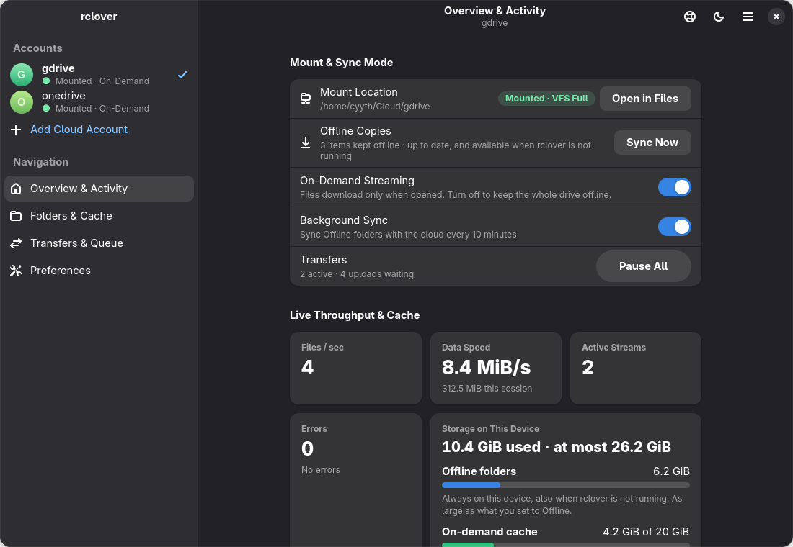

rclover
=======

rclover — rclone + clover

rclover is a GNOME app that mounts cloud drives under ``~/Cloud`` with
`rclone <https://rclone.org>`_. Files are downloaded when you open them, and the
folders you pin stay available offline.

.. toctree::
   :maxdepth: 2

   install
   usage
   configuration
   architecture
   dbus
